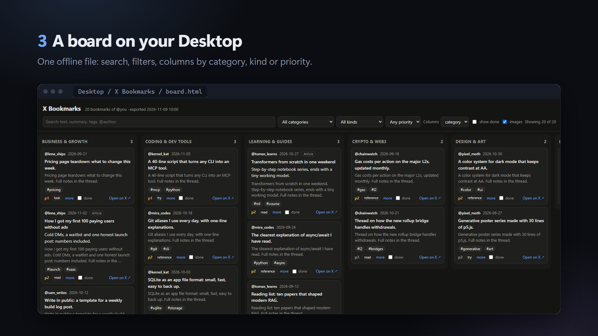
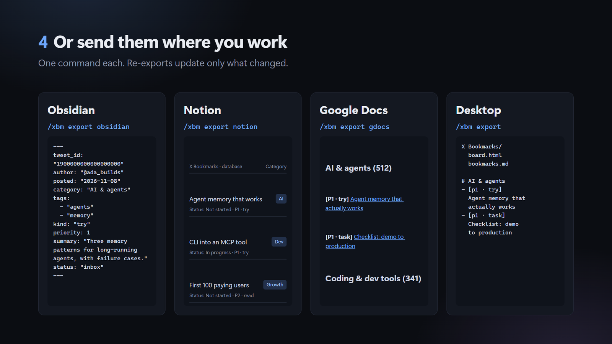

# hermes-x-bookmarks

A [Hermes Agent](https://github.com/NousResearch/hermes-agent) plugin that reads all your X
bookmarks, including long posts, threads and X Articles, sorts them with your own Hermes model and
exports them: a board on your Desktop, notes in Obsidian, a Notion database or a Google Doc.

```
/xbm sync       pull your bookmarks from X (the first run reads all of them)
/xbm classify   sort them: category, tags, kind, one-line summary, priority
/xbm export     write them out: desktop, obsidian, notion, gdocs (or all)
```

Works in any Hermes chat (`/xbm ...`) and in the terminal (`hermes xbm ...`).
Uses the official X API only: no scraping, no browser automation, read-only access.





## What it does

- **Sync.** Reads every bookmark the X API returns, newest first. The full text of X Articles
  (your bookmark is the Article, or quotes one) and long posts comes with it. Later syncs read small
  pages and stop as soon as they reach bookmarks already stored.
- **Sort.** Your Hermes model labels each bookmark: a category from your list, up to 5 tags, a kind
  (read, try, task, post-idea, reference, skill-candidate), a one-sentence summary, a priority
  (1-3) and why you probably saved it. Ten bookmarks per model call; nothing is sorted twice.
  Post text is passed to the model as data, never as instructions.
- **Desktop board.** `board.html` is one self-contained page: search, filters, columns by
  category, kind or priority, a "done" mark per card (kept in that browser). `bookmarks.md` is the
  same list as Markdown, grouped by category.
- **Obsidian.** One note per bookmark in your vault's `X Bookmarks` folder, with front matter
  (category, tags, kind, priority, summary, status) and the full post or Article text, plus an
  `X Bookmarks.base` table. Later exports update only the plugin's keys: your `status`, your own
  keys and anything you write in the note stay.
- **Notion.** A database "X Bookmarks" under a page you choose, with boards by category and by
  status. One page per bookmark with the text, quote, image and a link card. Re-exports update
  only what changed and never touch `Status` (yours to move); pages you delete stay deleted.
- **Google Docs.** One document "X Bookmarks", grouped by category, highest priority first, with
  links. Each export rewrites the same document, so its link and sharing stay.

Coming next: a weekly digest through Hermes cron, and turning a bookmark into a task, note or
Hermes skill. See [docs/PLAN.md](docs/PLAN.md).

## Setup

### 1. Your own X developer app

Every user brings their own X app and pays X for their own reads; nothing goes through a shared
app.

1. Sign in at [console.x.com](https://console.x.com) with the X account whose bookmarks you want.
   That account must own the app (that is what makes the "owned reads" price apply).
2. Create an app on the **Pay-per-use** plan, add credit and set a spending limit.
3. In the app's user authentication settings, set permissions to **Read**.
4. On **Keys and tokens**, copy the **API Key** and **API Key Secret**, then generate the
   **Access Token** and **Access Token Secret** (after setting Read, so they carry it).

### 2. Keys into Hermes

Put the four values in your Hermes profile's `.env` (`~/.hermes/.env`; on Windows
`%LOCALAPPDATA%\hermes\.env`):

```
XBM_X_API_KEY=...
XBM_X_API_SECRET=...
XBM_X_ACCESS_TOKEN=...
XBM_X_ACCESS_TOKEN_SECRET=...
```

The plugin reads them through Hermes' secret scope and never writes them anywhere. To revoke,
regenerate the tokens on X.

### 3. Install

```bash
hermes plugins install winchxyz/hermes-x-bookmarks --enable
hermes xbm whoami
```

`whoami` should print your handle. Then:

```bash
hermes xbm sync
hermes xbm classify --all
hermes xbm export
```

### 4. Export destinations (optional)

**Obsidian.** Nothing to set up if Obsidian has your vault open: the plugin finds it in
Obsidian's own `obsidian.json`. Otherwise set `obsidian_vault` to the vault folder. Then
`hermes xbm export obsidian`.

**Notion.**

1. Open [notion.so/profile/integrations](https://www.notion.so/profile/integrations) and create an
   **internal** connection for your workspace with Read, Update and Insert content. Copy its token.
2. Put it in the Hermes `.env`: `XBM_NOTION_TOKEN=...`
3. Make (or pick) a page for the database. On that page: **••• → Connections → add your
   connection**.
4. `hermes xbm export notion <that page's URL>` (the URL is remembered as `notion_page`).
   The first export of 1,880 bookmarks takes about 13 minutes (Notion allows ~3 requests a
   second); in chat it writes 100 per run, the terminal writes all.

**Google Docs.**

1. In the [Google Cloud console](https://console.cloud.google.com/) create a project and enable
   the **Google Docs API**.
2. **Google Auth Platform → Branding**: app name and your email. **Audience**: External, add
   yourself as a test user, then **Publish app** (In production); in Testing, Google ends the
   sign-in after 7 days. With only the `drive.file` scope no verification is needed; Google shows
   an "unverified app" screen once, which you can pass for your own app.
3. **Clients → Create client → Desktop app**. Put both values in the Hermes `.env`:
   `XBM_GOOGLE_CLIENT_ID=...` and `XBM_GOOGLE_CLIENT_SECRET=...`
4. `hermes auth add hermes-x-bookmarks:google` (opens the browser once), then
   `hermes xbm export gdocs`.

`drive.file` lets the plugin see and change only the document it created, nothing else in your
Drive.

Set `export_to` (for example `desktop, obsidian, notion`) to choose what a plain `export` does.

## Settings

Set in the Hermes Plugins settings, or with `/xbm about` for the last one.

| Setting | Default | What it does |
|---|---|---|
| `categories` | AI & agents, Coding & dev tools, Crypto & web3, Business & growth, Design & art, Learning & guides, News & opinion, Life & misc | Your category list, comma-separated. "Other" is always added. |
| `classify_language` | English | Language of summaries and the why-saved note |
| `about_me` | empty | A sentence on what you build and follow; used only to judge priority (`/xbm about <text>`) |
| `export_to` | desktop | What a plain `export` writes: desktop, obsidian, notion, gdocs |
| `export_dir` | `X Bookmarks` on your Desktop | Where `export desktop` writes |
| `obsidian_vault` | the vault Obsidian has open | Vault folder; notes go to `X Bookmarks/` in it |
| `notion_page` | empty | The Notion page that holds the database (shared with your connection) |
| `auth_backend` | auto | `keys` (above), `hermes` (OAuth 2.0 via `hermes auth add hermes-x-bookmarks:x`) or `xurl` |

Sorting runs on the plugin's own model slot, **X bookmarks: sorting**. It uses your main model
until you pick another one in `hermes model` (auxiliary tasks). A stronger model gives clearly
better priorities and fewer odd categories.

## Commands

| Chat | Terminal | |
|---|---|---|
| `/xbm sync [full]` | `hermes xbm sync [--full]` | Pull new bookmarks (`full` re-reads all) |
| `/xbm classify [N\|all]` | `hermes xbm classify [--limit N \| --all]` | Sort unsorted bookmarks (chat: 20 by default, max 100) |
| `/xbm export [where]` | `hermes xbm export [where] [--dir PATH]` | `desktop`, `obsidian`, `notion [page URL]`, `gdocs`, `all`; several allowed |
| `/xbm status` | `hermes xbm status` | Counts, categories, last runs, X API and model use |
| `/xbm list [N] [category]` | `hermes xbm list [--limit N] [--category C]` | Most recent bookmarks with their labels |
| `/xbm about [text\|clear]` | `hermes xbm about [text]` | Show or set what you build and follow |

## Cost

- **X API** (paid to X, on your app). Reading your own bookmarks is an "owned read": about
  **$0.001 per post**. The author's first full sync of 1,880 bookmarks took 22 requests and about
  **$1.89**; a sync with nothing new reads 10 posts, about $0.01. From 2026-11-22 X also bills
  the expanded objects that come with each page (authors, images, quoted posts): on the same
  1,880 bookmarks that is about 3,650 more objects, so a full sync costs roughly 3x.
  `/xbm status` shows an estimate per run.
- **Model** (your provider). Sorting 1,880 bookmarks took 188 calls, about 500k input and 200k
  output tokens. On a free model that was $0.

## Privacy, network and files

What the plugin touches, so you know before installing:

- **Network.** `api.x.com` (your bookmarks, read-only) and your Hermes model provider (sorting).
  Only when you export there: `api.notion.com`, and `docs.googleapis.com` through Hermes' Google
  sign-in. Nothing else, no telemetry.
- **Data.** Bookmarks, labels, run history and export ids live in Hermes plugin data (SQLite) on
  your machine. No keys or tokens are stored there.
- **Credentials.** The X keys and the Notion token are read from the Hermes `.env` through
  Hermes' secret scope; the X OAuth 2.0 and Google sign-ins are kept and refreshed by Hermes.
  The plugin never writes a credential.
- **Files outside plugin data.** `export desktop` writes `X Bookmarks/` on your Desktop (or
  `export_dir`); `export obsidian` writes notes into your vault's `X Bookmarks/` folder and reads
  Obsidian's `obsidian.json` to find the vault (vault paths only).
- **Commands.** None, unless you choose the `xurl` sign-in, which runs `xurl token`.
- Post text goes to the model you configured in Hermes and to the destinations you export to.

## Limits

- X Article bodies come from the API as plain text (no headings, links or images inside).
- Threads: each bookmarked post is stored on its own; the rest of the thread is not fetched yet.
- Removing a bookmark on X does not yet remove it here.

## Development

```bash
pip install -e . -r requirements-dev.txt
ruff check .
pytest -q
```

Design and research notes: [docs/ARCHITECTURE.md](docs/ARCHITECTURE.md),
[docs/DECISIONS.md](docs/DECISIONS.md), [docs/research/](docs/research/).
CI runs ruff, pytest, and `hermes plugins validate` / `doctor` against Hermes v0.23.0 and main.

## License

MIT
